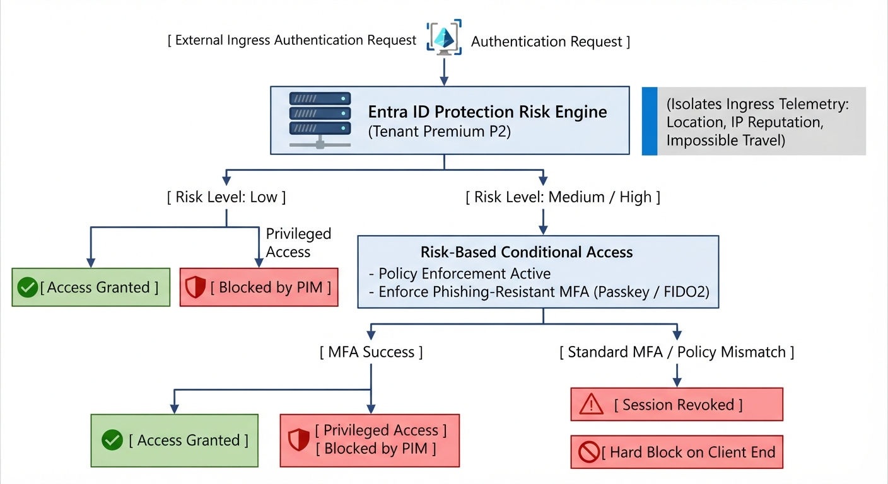
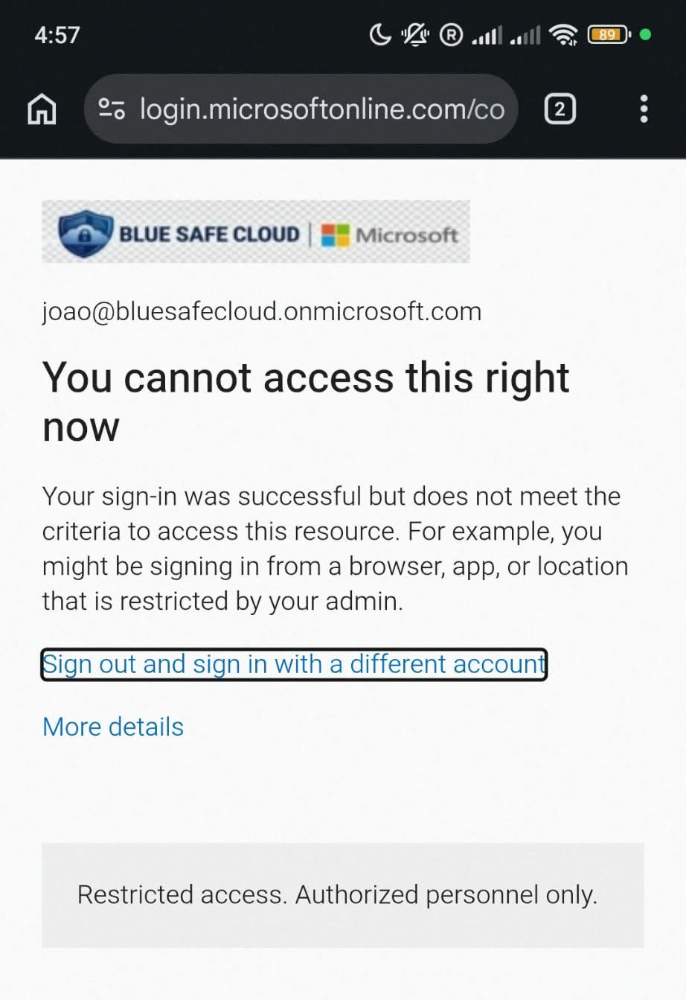
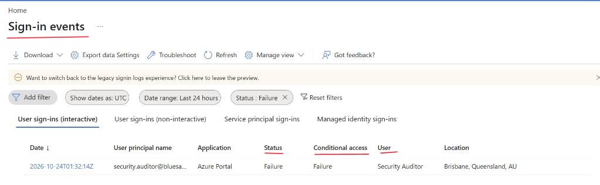

# Enterprise Identity Protection & Zero Trust Session Security

## 1. Problem & Solution Overview
* **The Problem:** Static identity perimeters (username/password) are highly vulnerable to session hijacking, proxy-phishing, and unauthorized remote access. Legacy IT support models act reactively, resetting credentials only after a directory breach has already occurred.
* **The Solution:** Deployment of an active **Zero Trust Identity Defense** within a dedicated enterprise tenant scope (**Blue Safe Cloud**). This framework utilizes risk-based identity telemetry to automatically intercept anomalous login attempts in real time, enforcing advanced authentication strengths and immediate perimeter blocks at the edge of the session.

---

## 2. Infrastructure & Technical Pipeline

The diagram below maps the complete end-to-end directory logic, risk evaluation split, and defense-in-depth enforcement layers architected for this project:

---

## 3. Core Policy Implementation (`CA-IdentityProtection-Risk-Enforcement`)

### A. Target Identity Scope
* **Target Account:** Non-administrative testing identity: `security.auditor@://onmicrosoft.com`.
* **Licensing Strategy:** Assigned a dedicated **Entra ID Premium P2 license** directly to the target profile to enable fine-grained directory audit visibility and prevent opaque logging blocks.

### B. Conditional Access Hardening Rules
* **Condition Trigger:** Configured to intercept logins immediately upon detection of **Medium or High Sign-in Risk** (e.g., Anomalous Travel or malicious egress proxy nodes).
* **Control Enforcement (Authentication Strengths):** Configured to completely bypass standard/legacy authentication methods (such as SMS OTP or basic Push Notifications) and mandate **Phishing-Resistant MFA** (FIDO2 Passkeys or Windows Hello for Business).

---

## 4. Empirical Proof of Concept & Live Evidence

To validate the defensive framework, an anomalous authentication sequence was forced via a remote network proxy outside the Baltic perimeter (**Brisbane, Queensland, Australia**).

### Figure 1: User-End Interception & Access Denial (Mobile View)
The user successfully supplied the correct password credentials. However, the Risk Engine calculated an anomalous ingress path. 

Because the account only possessed standard MFA registration factors (vulnerable to proxy-phishing), the Conditional Access engine determined the identity could not satisfy the strict criteria of **Phishing-Resistant MFA**. 

The engine bypassed sending standard SMS challenges to prevent potential MFA fatigue exploitation and executed an immediate **Hard Block** at the perimeter under the corporate branding layer.

  

### Figure 2: Admin-End Directory Auditing (Tenant SIEM View)
The corresponding directory log confirms the hard block execution. Telemetry isolated the fraudulent ingress origin to Brisbane, AU, routing the event as an immediate Conditional Access failure state and successfully protecting backend cloud assets from unauthorized exposure.

